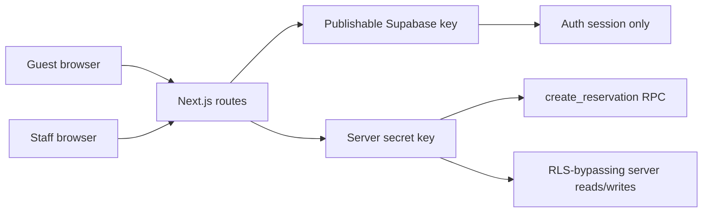

# Application architecture

Iturrieta Sagardotegia is a single Next.js 16 App Router deployment: marketing pages, guest booking APIs, manage-booking, and staff/admin operations share one codebase and one Postgres database (Supabase).

## Layers

| Layer | Location | Responsibility |
|-------|----------|----------------|
| Public UI | `app/[locale]/*`, `components/home`, `book`, … | Static and server-rendered guest content; three locales (`en`, `es`, `eu`) |
| Guest APIs | `app/api/bookings/*`, `app/api/manage-booking/*` | Validation, rate limits, service-role Supabase calls only on server |
| Staff UI | `app/staff/*`, `app/admin/*` | Auth session via Supabase SSR; mutations through server actions |
| Domain logic | `lib/booking`, `lib/staff`, `lib/floor`, … | Pure functions + tests; no browser secrets |
| Data | `supabase/migrations/` | RLS on all app tables; booking writes via RPC + locks |

## Trust boundaries

- **Browser** never receives `SUPABASE_SECRET_KEY`.
- **anon / authenticated** roles cannot `EXECUTE` booking RPCs ([booking-rpc-grants.md](./booking-rpc-grants.md)).
- **Rate limits** aggregate via Upstash when configured (`lib/api/rate-limit-upstash.ts`).

## Concurrency model

Reservation creation locks calendar rows and tables inside `private.create_reservation` (migration `20261026184605_restaurant_operations.sql`, updated in `20261027170000_fix_capacity_coalesce.sql`). The app does not rely on read-then-insert in TypeScript alone.

## Observability

- `GET /api/health` — configuration smoke test (no DB ping, no secrets).
- `GET /api/bookings/status` — public readiness for guest surfaces.

## Related

- [operations-setup.md](./operations-setup.md) — deploy and env
- [TESTING.md](./TESTING.md) — Vitest, Playwright, staging HTTP script
- [SCORECARD.md](./SCORECARD.md) — rubric evidence
